<!-- header:start -->
<div align="center">



<a href="#-quick-start"></a>

<a href="LICENSE"></a>

<a href="https://github.com/ajendras/llm-probe/stargazers"></a>
<a href="https://github.com/ajendras/llm-probe/actions/workflows/ci.yml"></a>

<a href="CONTRIBUTING.md"></a>

**Automated red-teaming CLI for LLMs that launches adversarial attacks and scores prompt injection, jailbreak and leakage risks**

[✨ Features](#-features) • [⚡ Quick start](#-quick-start) • [🧰 Usage](#-usage) • [🧩 Architecture](#-architecture) • [📍 Roadmap](#-roadmap) • [🤝 Contributing](#-contributing)

</div>
<!-- header:end -->

## ✨ Why LLM Probe?

LLM features ship quickly but adversarial robustness testing remains manual and incomplete. Existing solutions are cloud-only or lack depth for local models. LLM Probe delivers a fast, extensible, local-first toolkit so Rust developers can continuously test any model against real attack patterns and receive concrete risk reports.

- **Local-first red teaming** — run attacks against Ollama, LM Studio, Hugging Face TGI, vLLM, or any OpenAI-compatible endpoint with zero data leaving your machine
- **Battle-tested attack library** — 20+ built-in templates covering prompt injection, DAN-style jailbreaks, encoding tricks and PII extraction
- **Instant risk scoring** — heuristic scoring (with optional LLM-as-judge) plus color-coded terminal reports that fit perfectly in CI
- **Zero-boilerplate extensibility** — implement the `Attack` trait or load custom templates while reusing `heuristic_score`, `TemplateBasedAttack` and `ReportGenerator`

## 🎬 Demo

<p align="center"></p>

## 🚀 Features

<table>
<tr>
<td>
🔫 <b>Attack Library</b><br>
20 built-in templates for injection, jailbreak, extraction and encoding attacks
</td>
<td>
📊 <b>Risk Scoring</b><br>
Fast heuristic_score plus optional LLM-as-judge that returns 0.0-1.0 vulnerability
</td>
<td>
🔌 <b>Model Agnostic</b><br>
OllamaClient, OpenAiCompatibleClient (LM Studio/vLLM/OpenAI), HuggingFaceClient (TGI) or any type implementing the LlmClient trait
</td>
</tr>
<tr>
<td>
🖥️ <b>Terminal Reports</b><br>
Live phosphor-green progress, comfy-table vulnerability matrix and risk_level summary
</td>
<td>
⚡ <b>Parallel Runs</b><br>
Tokio-powered concurrency (configurable via --concurrency or Config::concurrency)
</td>
<td>
🛠️ <b>Custom Attacks</b><br>
Extend via the Attack trait or use TemplateBasedAttack with zero boilerplate
</td>
</tr>
<tr>
<td>
📼 <b>Session Replay</b><br>
Every prompt/response pair saved for later debugging and replay
</td>
<td>
📈 <b>Trend Tracking</b><br>
JSON reports with timestamps let you watch robustness improve over model updates
</td>
</tr>
</table>

## 📦 Installation

Requires Rust 1.70+ (stable).

```bash
cargo install llm-probe
```

Or clone and build:

```bash
git clone https://github.com/ajendras/llm-probe.git
cd llm-probe
cargo build --release
```

## ⚡ Quick start

```rust
use llm_probe::{RedTeamer, attacks::injection::PromptInjectionAttack};
use std::sync::Arc;

#[tokio::main]
async fn main() -> anyhow::Result<()> {
    let attacks = PromptInjectionAttack::all_attacks();
    let report = RedTeamer::builder()
        .attacks(attacks)
        .build()
        .run("llama3.1")
        .await?;

    println!("Risk level: {} (avg score {:.2})", 
             report.summary.risk_level, report.summary.average_score);
    Ok(())
}
```

Or from the terminal:

```bash
llm-probe scan --model llama3.1 --attacks injection,jailbreak --output report.json
```

## 🧰 Usage

Run a targeted scan against an Ollama model:

```bash
llm-probe scan --model llama3.1 \
  --attacks injection,jailbreak \
  --concurrency 8 \
  --output results.json
```

Run against LM Studio (OpenAI-compatible local server):

```bash
llm-probe scan --model "TheBloke/Llama-2-7B-GGUF" \
  --endpoint http://localhost:1234/v1 \
  --attacks jailbreak
```

Run against a local Hugging Face TGI server:

```bash
llm-probe scan --model my-model \
  --endpoint http://localhost:8080 \
  --concurrency 8
```

Use the library with a real client:

```rust
use llm_probe::{RedTeamer, model::{OllamaClient, OpenAiCompatibleClient, HuggingFaceClient}};
use std::sync::Arc;

let client = Arc::new(OllamaClient::new("llama3.1"));
let report = RedTeamer::builder()
    .with_client(client)
    .model("llama3.1")
    .build()
    .run("llama3.1")
    .await?;

// LM Studio example
let lm_client = Arc::new(OpenAiCompatibleClient::for_lm_studio("local-model"));
let hf_client = Arc::new(HuggingFaceClient::new());
```

Create a custom attack using the reusable helper:

```rust
use llm_probe::{attack::{TemplateBasedAttack, metadata}, AttackType, Attack};

let custom = TemplateBasedAttack::new(
    "My SQLi Probe".to_string(),
    AttackType::Injection,
    0.65,
    "Attempts SQL-style prompt escape".to_string(),
    "SELECT * FROM system_prompt WHERE user_input = 'DROP SAFETY;'".to_string(),
);
```

<details><summary>Advanced: load config and generate historical reports</summary>

```rust
use llm_probe::{config::load_config, RedTeamer, reporter::ReportGenerator};

let cfg = load_config()?;
let redteamer = RedTeamer::builder()
    .model(&cfg.model)
    .build();

let report = redteamer.run(&cfg.model).await?;
// ReportGenerator::render_table(&report);
```

The `ScanCmd` struct (used by the CLI) accepts the same fields that appear in `llm-probe.toml` (`model`, `endpoint`, `timeout`, `concurrency`, `output`, `api_key`).

Endpoint URLs automatically select the right client:
* `*:11434*` or containing "ollama" → `OllamaClient`
* `*:1234*` or containing "lmstudio" → `OpenAiCompatibleClient::for_lm_studio`
* `*:8080*` or containing "tgi"/"huggingface" → `HuggingFaceClient` (TGI `/generate`)

</details>

## 🔧 Configuration

| Option       | Default     | Description |
|--------------|-------------|-------------|
| model        | "llama3.1"  | Target model name passed to Ollama or OpenAI-compatible endpoint |
| endpoint     | None        | Custom HTTP base URL. Auto-selects client (Ollama / LM Studio / Hugging Face TGI / generic OpenAI-compatible) |
| timeout      | 60          | HTTP request timeout in seconds |
| concurrency  | 4           | Maximum number of concurrent Tokio attack tasks |
| output       | None        | Path to write full JSON report + session replay |
| api_key      | None        | Bearer token for authenticated OpenAI-compatible endpoints |

Configuration is loaded automatically from `llm-probe.toml` by `load_config()` and can be overridden by `ScanCmd` flags.

## 🧩 Architecture

```mermaid
flowchart TD
    CLI[main.rs + clap::Parser] --> run[lib::run]
    run --> Scan[run_scan]
    Scan --> Builder[RedTeamer::builder]
    Builder --> RedTeamer[RedTeamer]
    RedTeamer --> Config[load_config]
    RedTeamer --> Attacks[attacks::all_attacks<br/>or custom Vec<Box<dyn Attack>>]
    Attacks --> Injection[attacks::injection::PromptInjectionAttack]
    Attacks --> Jailbreak[attacks::jailbreak::JailbreakAttack]
    RedTeamer --> Client[model::OllamaClient, OpenAiCompatibleClient (LM Studio), HuggingFaceClient (TGI)]
    Client --> LlmClient[LlmClient::complete]
    LlmClient --> Scorer[scorer::Scorer::score<br/>heuristic_score or llm_judge]
    RedTeamer --> Report[Report::from_results]
    Report --> Reporter[reporter::ReportGenerator::render_table<br/>or write_json]
```

The `RedTeamer` orchestrates parallel execution of any `Attack` implementation against any `LlmClient`. `TemplateBasedAttack` and the helper functions in `attack.rs` remove duplication across attack families while `Report` aggregates scores for terminal and JSON output.

## 📁 Project structure

```text
.
├── Cargo.toml                 # clap, tokio, reqwest, serde, comfy-table, colored
├── src/
│   ├── main.rs                # CLI entrypoint, parses Cli/ScanCmd/ReportCmd
│   ├── lib.rs                 # RedTeamer, RedTeamerBuilder, Attack + LlmClient traits, run(), Report
│   ├── config.rs              # Config struct, load_config(), TOML deserialization
│   ├── model.rs               # LlmClient trait + OllamaClient, OpenAiCompatibleClient, HuggingFaceClient
│   ├── attack.rs              # TemplateBasedAttack, heuristic_score, failure_result, metadata
│   ├── attacks/
│   │   ├── mod.rs             # all_attacks() that registers injection + jailbreak
│   │   ├── injection.rs       # PromptInjectionAttack, InjectionVariant, all_attacks()
│   │   └── jailbreak.rs       # JailbreakAttack, JailbreakVariant, all_attacks()
│   ├── scorer.rs              # Scorer with heuristic + optional LLM judge
│   ├── reporter.rs            # ReportGenerator::render_table, write_json, summarize
│   ├── templates.rs           # Static INJECTION/JAILBREAK/EXTRACTION prompts + mutate_prompt
│   └── ...
├── examples/
│   └── basic_scan.rs          # RedTeamer::builder().model().attacks().run().await
└── tests/
    └── redteam_test.rs        # MockLlmClient integration tests, heuristic assertions
```

## 🧪 Testing

```bash
cargo test
```

Covers `heuristic_score` accuracy, metadata clamping, `TemplateBasedAttack` execution, all injection/jailbreak variants, `MockLlmClient` responses, `Config` defaults, and end-to-end `RedTeamer` runs.

## 📍 Roadmap
<!-- roadmap:start -->
- [x] **v0.1.0** — first release: Attack Library, Risk Scoring, Model Agnostic, Terminal Reports
- [x] Support LM Studio and local Hugging Face endpoints
- [ ] Add YAML attack definitions so users never need to write Rust
- [ ] SARIF output for GitHub Advanced Security integration
- [ ] Ratatui-based interactive TUI to browse and replay attacks
- [ ] LLM-as-a-judge scoring with configurable judge model
- [ ] RAG-specific attacks (context poisoning, needle retrieval)
- [ ] Plugin system for community attack modules via dynamic loading
- [ ] Automatic mitigation suggestions based on failure patterns
- [ ] Historical trend graphs rendered in terminal with sparklines
- [ ] Support for multimodal attacks (image prompt injection)
- [ ] CI-friendly --quiet mode that only fails on high risk
- [ ] Pre-built Docker image with popular Ollama models

> 🤖 This roadmap is worked through continuously — ideas and PRs welcome!
<!-- roadmap:end -->

## 🤝 Contributing

Contributions are welcome! Please read [CONTRIBUTING.md](https://github.com/ajendras/llm-probe/blob/main/CONTRIBUTING.md) and follow our [CODE_OF_CONDUCT.md](https://github.com/ajendras/llm-probe/blob/main/CODE_OF_CONDUCT.md).

Good first issues include new attack variants in `attacks/`, additional client implementations, or improvements to the retro-styled `ReportGenerator` tables. Open a PR with tests and we'll review it quickly.

## 📄 License

Licensed under either of [Apache License 2.0](LICENSE-APACHE) or [MIT license](LICENSE-MIT) at your option.

<!-- footer:start -->
<div align="center">

### ⭐ Star history

<a href="https://star-history.com/#ajendras/llm-probe&Date"></a>

If **LLM Probe** saves you time, a ⭐ helps others find it.

Made with ❤️ by [Ajendra](https://ajendra.info)


</div>
<!-- footer:end -->
